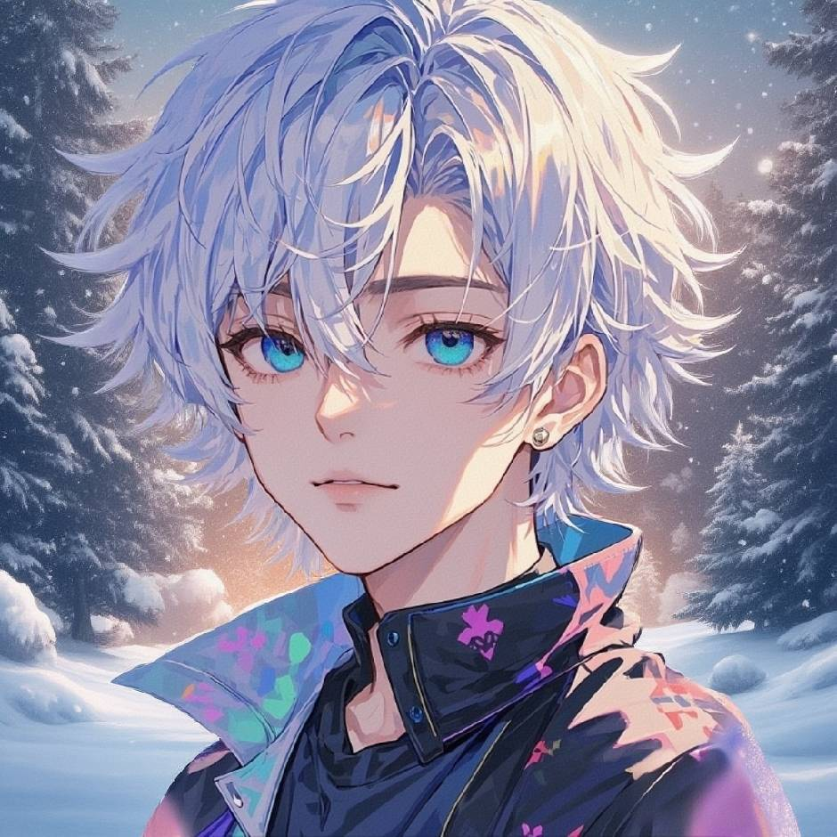

# 阿伟个人 IP 海外站首页改动说明

## 改动目标

将原有 AI 工具箱首页调整为阿伟的中文个人品牌主页。网站部署在海外，面向中文用户，主要用于获取以下咨询：

1. AI 项目代开发
2. 企业 AI 内训
3. 一对一 AI 应用陪跑

页面同时保留现有免费工具，作为访客体验入口和个人开发能力展示。

## 个人定位与文案

- 品牌名称：阿伟
- 定位：AI 应用开发与落地
- 主要身份：资深 Java 开发者、技术顾问、讲师
- Java 开发经验：10 年
- 技术经理经验：3 年
- 业务经历：任职期间参与欧莱雅、Dior 等品牌相关电商会员运营项目
- 社群与教学经历：西安 AI 先锋社核心成员；西安 AI 实战训练营师资团队负责人及优秀讲师
- 内容经历：公众号「阿伟AI说」单篇阅读量 40 万+；AI 编程垂直社群 90+ 名成员

首页主标题为“把 AI 想法，做成可用的应用。”，首要行动按钮为“添加微信，聊聊需求”。

## 文件变更

### `index.html`

重做为个人品牌主页，包含：

- 顶部导航：服务、关于我、免费工具、内容分享、需求咨询
- 首屏个人定位、服务简介和“业务需求 → 应用方案 → 开发实现 → 落地使用”流程图
- 个人经验数据：10 年 Java 开发、3 年技术经理、业务 × 技术 × AI
- 三项服务：项目开发、企业内训、一对一应用陪跑
- 关于阿伟：技术背景、品牌项目经历和培训经历
- 免费工具入口
- 公众号内容数据与 X 跳转
- 微信咨询弹窗
- 邮件联系入口
- 移动端和桌面端响应式布局

免费工具点击后会在全屏对话框中加载，工具页可返回主页，也可以独立新标签打开。通过 URL hash 支持直接打开指定工具。

### `assets/home.css`

新增首页样式：

- 浅色背景、深色文字、统一蓝色强调色
- 顾问型个人品牌视觉，避免依赖真人照片和外部字体
- 网格背景流程图、服务区块、工具列表、内容订阅区和联系区
- 统一圆角、边框、间距和按钮样式
- 支持 1000px 和 767px 断点
- 支持 `prefers-reduced-motion`
- 包含二维码、头像和联系弹窗的样式

### `assets/home.js`

新增首页交互：

- 点击任意“添加微信”或服务咨询按钮，打开微信咨询弹窗
- 根据按钮自动显示咨询方向，例如项目开发、企业内训或一对一陪跑
- 点击免费工具，在站内全屏打开对应 HTML 工具
- 支持返回主页、独立打开和关闭工具
- 关闭工具后恢复 URL 状态和焦点

### `tools.html`

从原 `index.html` 保留出的 AI 工具箱页面。它继续提供原有工具搜索、分类筛选、主题切换、GitHub Star 计数和 iframe 工具打开功能。

### `assets/awei-avatar.jpg`

阿伟头像，来源于用户提供的图片，用于：

- 顶部导航头像
- “关于阿伟”区域头像

### `assets/wechat-contact.png`

个人微信二维码，用于首页“添加微信”咨询弹窗。

### `assets/wechat-official.jpg`

公众号二维码，用于“阿伟AI说”内容区域。

### `README.md`

更新项目说明、预览方式、文件结构、联系方式和外部服务说明。

## 联系方式

- 个人微信二维码：已接入 `assets/wechat-contact.png`
- 公众号二维码：已接入 `assets/wechat-official.jpg`
- 邮箱：`ww1150434308@gmail.com`
- X：[@aweiai2035](https://x.com/aweiai2035)

微信和公众号二维码支持点击查看原图。邮箱使用 `mailto:` 链接打开本地邮件客户端。

## 免费工具

- Markdown 转 PDF / HTML：`md2pdf/index.html`
- 图表转高清图片：`photo/diagram-converter.html`
- PDF 转图片：`photo/pdf2imageV2.html`

工具仍然免费使用。部分工具依赖 CDN；PlantUML 图表渲染会调用外部渲染服务，因此页面没有继续宣传“所有工具完全离线”或“所有数据均不离开浏览器”。

## 本地预览

在项目根目录运行：

```bash
python -m http.server 8765 --bind 127.0.0.1
```

然后访问：<http://127.0.0.1:8765/>

## 已完成验证

- 首页桌面布局显示正常
- 手机宽度下无横向溢出
- 微信咨询弹窗可以打开和关闭
- 个人微信二维码和公众号二维码均能加载
- Markdown 工具可以在站内打开并返回主页
- X 链接可以跳转
- 邮箱链接存在并指向 `ww1150434308@gmail.com`
- `assets/home.js` 通过 Node 语法检查
- `git diff --check` 通过

## 上线前可补充

- 真实邮箱展示文案或邮箱图标
- 更完整的项目案例和客户反馈
- 服务价格或“起步价”
- 训练营报名页面
- 个人微信号文字
- 网站正式域名和站点统计工具


## 完整源码

以下代码与项目当前文件保持一致。图片资源为二进制文件，不内嵌到 Markdown。

### `index.html`

```html
<!doctype html>
<html lang="zh-CN"><head><meta charset="utf-8"><meta name="viewport" content="width=device-width,initial-scale=1"><title>阿伟 · AI 应用开发与落地</title><meta name="description" content="阿伟，10年Java开发经验，提供AI项目开发、企业内训与一对一Agent应用陪跑。西安为主，支持远程合作。"><link rel="stylesheet" href="assets/home.css"><script defer src="assets/home.js"></script></head><body>
<header><nav class="wrap"><a class="brand" href="#"><span>阿伟<small>AI 应用开发与落地</small></span></a><div class="links"><a href="#services">服务</a><a href="#about">关于我</a><a href="#tools">免费工具</a><a href="#content">内容分享</a></div><a class="btn compact" href="#contact">聊聊需求 ↗</a></nav></header>
<main><section class="wrap hero"><div><p class="eyebrow">独立技术顾问 · 西安 / 远程合作</p><h1>把 AI 想法，<br>做成<span>可用的应用。</span></h1><p class="intro">我是阿伟。从业务需求出发，提供 AI 应用开发、企业内训与一对一陪跑，陪你走完从想法到落地的每一步。</p><div class="actions"><button class="btn" data-contact="项目需求">添加微信，聊聊需求 ↗</button><a href="#services">了解服务 ↓</a></div></div><div class="blueprint"><div class="plan-head"><span>从一个想法开始</span><span>IDEA → BUILD</span></div><div class="node start"><i>01</i><div><strong>业务需求</strong><small>找到真正值得解决的问题</small></div></div><div class="line"></div><div class="pair"><div class="node"><i>02</i><div><strong>应用方案</strong><small>让技术服务于目标</small></div></div><span>→</span><div class="node"><i>03</i><div><strong>开发实现</strong><small>把方案变成应用</small></div></div></div><div class="line right"></div><div class="node finish"><i>04</i><div><strong>落地使用</strong><small>进入真实的工作场景</small></div><b>↗</b></div><p class="plan-foot">让每一步，都离解决问题更近。</p></div></section>
<div class="wrap credentials"><div><strong>10<small>年</small></strong><p>Java 开发经验</p></div><div><strong>3<small>年</small></strong><p>技术经理经验</p></div><div><strong class="words">业务 × 技术 × AI</strong><p>从电商系统实践，到 AI 应用落地</p></div></div>
<section class="wrap section" id="services"><p class="eyebrow">合作方式</p><h2>你的下一步，<br>我们一起往前走。</h2><p>需要完整交付、团队赋能，或是有人陪你做出第一个应用？</p><article class="featured"><div><label>项目开发</label><h3>你提出问题，<br>我把应用做出来。</h3><p>围绕真实业务，梳理需求、设计方案、推进开发。重点承接 AI 相关项目，具体交付范围根据需求确定。</p><button class="text-btn" data-contact="AI 项目开发">聊聊我的项目 ↗</button></div><div class="scope"><p>可沟通的项目方向</p><div><small>01</small> Agent 应用开发</div><div><small>02</small> AI 能力接入业务系统</div><div><small>03</small> 具体工作场景的 AI 应用</div><p>先了解目标，再讨论技术和方案。</p></div></article><div class="secondary"><article><label>企业内训</label><h3>让团队，把 AI 用起来。</h3><p>面向研发团队开展 AI 编程与 Agent 实战；面向管理者和业务团队开展 AI 应用与工作提效培训。根据需求主讲或协调讲师资源。</p><div class="service-bottom"><small>西安为主 · 支持线上</small><button class="text-btn" data-contact="企业内训">沟通内训需求 ↗</button></div></article><article><label>一对一陪跑</label><h3>你来动手，我陪你落地。</h3><p>面向开发者，围绕一个具体的 AI 应用，拆解需求、讨论方案、解决开发问题，一起推进到可部署的成果。</p><div class="service-bottom"><small>线上一对一 · 项目实战</small><button class="text-btn" data-contact="一对一应用陪跑">聊聊应用目标 ↗</button></div></article></div><p class="aside">想用 AI 打造个人 IP、启动自媒体账号？<button class="text-btn" data-contact="AI 个人 IP 陪跑">也可以聊聊你的计划 ↗</button></p></section>
<section class="about" id="about"><div class="wrap about-grid"><div><p class="eyebrow">关于阿伟</p><h2>懂开发，<br>也懂项目如何向前。</h2><div class="signature profile-signature"><div>阿伟<small>开发者 / 技术顾问 / 讲师</small></div></div></div><div><p class="lead">10 年代码与项目实践，让我更关注一件事：技术最终解决了什么问题。</p><p>我是一名资深 Java 开发者，有 3 年技术经理经验，深耕电商会员运营定制方案落地。任职期间，参与过欧莱雅、Dior 等品牌相关项目。</p><p>现在，我将开发与项目经验延伸到 AI 应用实践，关注如何把 AI 能力接入真实业务，也通过授课和陪跑分享自己的方法。</p><div class="roles">西安 AI 先锋社核心成员<br>西安 AI 实战训练营师资团队负责人 · 优秀讲师</div></div></div></section>
<section class="wrap section" id="tools"><p class="eyebrow">免费工具</p><h2>先解决一个手边的小问题。</h2><p>我开发的实用工具，免费开放。无需登录，打开就能用。</p><div class="tool-list"><a class="tool" href="md2pdf/index.html" data-tool="md2pdf"><span class="symbol">M↓</span><div><h3>Markdown 转 PDF / HTML</h3><p>整理 AI 输出与学习资料，实时预览，一键导出。</p></div><small>文档转换</small><span class="use">免费使用 ↗</span></a><a class="tool" href="photo/diagram-converter.html" data-tool="diagram"><span class="symbol">⌘</span><div><h3>图表转高清图片</h3><p>把流程与架构图，变成清晰可分享的 PNG / SVG。</p></div><small>图表导出</small><span class="use">免费使用 ↗</span></a><a class="tool" href="photo/pdf2imageV2.html" data-tool="pdf2image"><span class="symbol">▤</span><div><h3>PDF 转图片</h3><p>按页转换、批量导出，方便分享与整理文档素材。</p></div><small>图片处理</small><span class="use">免费使用 ↗</span></a></div><a class="all-tools" href="tools.html">打开完整工具箱 →</a></section>
<section class="wrap content" id="content"><div><p class="eyebrow">持续实践，持续分享</p><h2>做过的尝试，<br>也分享给你。</h2><p>在「阿伟AI说」和 AI 编程社群里，分享 AI 编程、应用开发，以及用 AI 创作内容的实践经验。</p><div class="stats"><div><strong>40 万+</strong><small>公众号单篇阅读量</small></div><div><strong>90+</strong><small>AI 编程社群成员</small></div></div><a class="text-btn" href="https://x.com/aweiai2035" target="_blank" rel="noopener noreferrer">在 X 关注 @aweiai2035 ↗</a></div><div class="subscribe"><a class="qr-image official-qr" href="assets/wechat-official.jpg" target="_blank" rel="noopener" aria-label="查看阿伟AI说公众号二维码原图"></a><h3>阿伟AI说</h3><p>扫码关注公众号<br>一起探索 AI 的实际用法</p></div></section>
<section class="wrap contact" id="contact"><div><p class="eyebrow">从一次交流开始</p><h2>有个想法？<br>聊聊怎么实现。</h2><p>告诉我你想做什么、目前进展到哪里，<br>以及希望解决的问题。先了解需求，再讨论合作。</p><button class="btn" data-contact="需求沟通">添加微信，聊聊需求 ↗</button><p class="aside">邮件联系：<a class="text-btn" href="mailto:ww1150434308@gmail.com">ww1150434308@gmail.com</a></p></div><div class="note"><strong>开始之前，可以想一想</strong><ol><li>你希望解决什么问题？</li><li>目前有哪些系统或资料？</li><li>期望的时间和大致预算？</li></ol><p>还没有完整方案也没关系，<br>带着问题来就好。</p></div></section></main>
<footer class="wrap"><a class="brand" href="#">阿伟 <small>AI 应用开发与落地</small></a><span>© <span id="year">2026</span> 阿伟</span><a href="https://x.com/aweiai2035" target="_blank" rel="noopener noreferrer">X ↗</a></footer>
<dialog id="contact-dialog" aria-labelledby="contact-title"><button class="close" aria-label="关闭联系窗口">×</button><p class="eyebrow">先了解需求，再讨论合作</p><h2 id="contact-title">聊聊你的需求</h2><p id="topic"></p><a class="qr-image contact-qr" href="assets/wechat-contact.png" target="_blank" rel="noopener" aria-label="查看阿伟AI个人微信二维码原图"></a><p>使用微信扫码，添加阿伟为好友。<br>手机上可点击图片查看原图，再长按识别或保存至相册扫码。</p><button class="btn done">知道了</button></dialog>
<dialog id="tool-dialog" aria-labelledby="tool-title"><div class="tool-bar"><button id="back" class="text-btn">← 返回主页</button><strong id="tool-title">免费工具</strong><a id="external" target="_blank" rel="noopener">独立打开 ↗</a></div><iframe title="免费工具" id="frame" src="about:blank"></iframe></dialog>
</body></html>


```

### `assets/home.css`

```css
/* Consultant portfolio: native CSS, variance 4, motion 2, density 3. Light theme follows approved brief. */
:root{--bg:#f8f9fb;--paper:#fff;--ink:#172a3c;--muted:#5c6977;--blue:#2458d3;--line:#dce2e9;--soft:#edf2fc;font-family:"Segoe UI","PingFang SC","Microsoft YaHei",sans-serif;color:var(--ink);background:var(--bg)}*{box-sizing:border-box}html{scroll-behavior:smooth;scroll-padding-top:100px}body{margin:0}body.modal{overflow:hidden}a{color:inherit;text-decoration:none}button{font:inherit;cursor:pointer;border:0}button:focus-visible,a:focus-visible{outline:3px solid var(--blue);outline-offset:5px}p{line-height:1.9;color:var(--muted);font-size:14px}h1,h2,h3,p{margin-top:0}h1,h2,h3{letter-spacing:-.045em}h2{font-size:clamp(29px,3.3vw,42px);line-height:1.4;margin-bottom:20px}h3{font-size:24px;line-height:1.5}small{font-size:12px;color:var(--muted)}.wrap{max-width:1180px;margin-inline:auto;width:calc(100% - 80px)}header{position:sticky;top:0;background:rgba(248,249,251,.97);z-index:5;border-bottom:1px solid var(--line)}nav{height:80px;display:flex;align-items:center;gap:30px}.brand{display:flex;align-items:center;gap:12px;font-size:21px;font-weight:750;white-space:nowrap}.mark{font-size:27px;letter-spacing:-7px;width:44px;height:44px;background:var(--ink);color:white;padding:2px 6px;border-radius:8px}.brand small{display:block;font-size:10px;font-weight:400;letter-spacing:1px;margin-top:3px}.links{display:flex;gap:30px;margin-left:auto;font-size:14px}.links a:hover,.text-btn:hover{color:#143c9c}.btn{display:inline-flex;justify-content:center;align-items:center;background:var(--blue);color:white;padding:16px 23px;border-radius:8px;font-size:14px;font-weight:600;white-space:nowrap;transition:background .18s,transform .18s}.btn:hover{background:#1744af;transform:translateY(-2px)}.compact{padding:12px 18px}.hero{display:grid;grid-template-columns:1.15fr 1fr;gap:55px;padding-block:82px 72px;align-items:center}.eyebrow{font-size:12px;letter-spacing:1.5px;color:var(--blue);font-weight:600;margin-bottom:23px}.hero h1{font-size:clamp(36px,4.3vw,57px);line-height:1.3;margin-bottom:26px;letter-spacing:-.065em}.hero h1 span{color:var(--blue)}.intro{font-size:16px;max-width:490px;line-height:1.95;margin-bottom:30px}.actions{display:flex;align-items:center;gap:28px;font-size:14px}.blueprint{border:1px solid var(--line);border-radius:16px;padding:25px;background-color:#f0f4fa;background-image:linear-gradient(#dce4ef70 1px,transparent 1px),linear-gradient(90deg,#dce4ef70 1px,transparent 1px);background-size:24px 24px}.plan-head{display:flex;justify-content:space-between;font-size:11px;color:var(--muted);margin-bottom:30px}.plan-head span:last-child{font:10px Consolas,monospace}.node{display:flex;align-items:center;gap:12px;background:var(--paper);border:1px solid #d6deeb;border-radius:8px;padding:17px 14px;box-shadow:0 4px 12px #1c345608}.node strong{font-size:14px}.node small{display:block;font-size:10px;margin-top:6px}.node i{font:11px Consolas,monospace;color:var(--blue)}.start{width:72%}.line{width:1px;height:25px;background:#a8b9d9;margin-left:30px}.pair{display:grid;grid-template-columns:1fr 22px 1fr;align-items:center}.pair .node{padding:16px 11px;gap:8px}.pair>span{text-align:center;color:var(--blue)}.line.right{margin-left:76%}.finish{margin-left:auto;width:76%;border-color:#98b0e7;background:#edf2ff}.finish b{margin-left:auto;color:var(--blue);font-size:22px}.plan-foot{font-size:11px;margin:23px 0 0}.credentials{border-block:1px solid var(--line);display:grid;grid-template-columns:1fr 1fr 1.5fr;padding-block:26px}.credentials>div{padding-left:38px;border-left:1px solid var(--line);display:flex;flex-direction:column;justify-content:center}.credentials>div:first-child{padding-left:0;border-left:0}.credentials strong{font-size:36px;font-weight:600;letter-spacing:-1px}.credentials strong small{font-size:14px;margin-left:7px}.credentials p{font-size:12px;margin:5px 0 0}.credentials .words{font-size:20px;letter-spacing:0}.section{padding-block:88px}.section>.eyebrow{margin-bottom:15px}.featured{display:grid;grid-template-columns:1.1fr 1fr;gap:80px;padding:44px;border:1px solid #ccd8f0;background:var(--soft);border-radius:16px;margin-top:36px}label{font-size:12px;color:var(--blue);display:block;margin-bottom:14px;font-weight:600}.featured h3{font-size:32px;margin-bottom:18px}.text-btn{padding:0;background:none;font-size:13px;font-weight:600;color:var(--blue);line-height:1.7}.featured .text-btn{margin-top:12px}.scope{align-self:center}.scope>p{font-size:12px}.scope>div{display:flex;align-items:center;gap:18px;border-bottom:1px solid #d1dced;padding:21px 0;font-size:16px}.scope small{font:11px Consolas,monospace;color:var(--blue)}.scope p:last-child{margin:18px 0 0}.secondary{display:grid;grid-template-columns:1fr 1fr;gap:24px;margin-top:24px}.secondary article{padding:32px;background:var(--paper);border:1px solid var(--line);border-radius:16px;display:flex;flex-direction:column}.secondary h3{margin-bottom:14px}.secondary p{margin-bottom:26px}.service-bottom{display:flex;justify-content:space-between;align-items:center;gap:12px;margin-top:auto}.service-bottom small{font-size:11px}.aside{font-size:12px;margin:22px 0 0}.about{background:#eef1f5;border-block:1px solid var(--line);padding-block:75px}.about-grid{display:grid;grid-template-columns:1fr 1.25fr;gap:100px}.signature{font-size:26px;margin-top:44px;font-weight:600}.signature small{display:block;font-size:11px;font-weight:400;margin-top:8px}.lead{font-size:20px;color:var(--ink);line-height:1.8;margin-bottom:24px}.roles{border-top:1px solid #d3dce5;padding-top:20px;font-size:12px;color:var(--muted);line-height:2.4}.tool-list{border-top:1px solid var(--line);margin-top:32px}.tool{display:grid;grid-template-columns:64px 1fr 100px 110px;gap:24px;align-items:center;padding:28px 14px;border-bottom:1px solid var(--line);transition:background .18s}.tool:hover{background:var(--soft)}.symbol{display:grid;place-items:center;width:54px;height:54px;background:var(--soft);color:var(--blue);border:1px solid #d9e3f7;border-radius:8px;font:23px Consolas,monospace}.tool h3{font-size:18px;margin:0 0 6px}.tool p{font-size:12px;margin:0}.tool small{font-size:11px}.use{font-size:13px;color:var(--blue);text-align:right}.all-tools{display:block;margin-top:22px;font-size:12px;color:var(--muted);text-align:right}.content{display:grid;grid-template-columns:1fr 300px;gap:90px;background:var(--paper);padding:48px 60px;border:1px solid var(--line);border-radius:16px}.content p{max-width:520px}.stats{display:flex;gap:50px;margin:28px 0}.stats strong{display:block;font-size:28px;font-weight:600}.stats small{display:block;font-size:11px;margin-top:8px}.subscribe{border-left:1px solid var(--line);padding-left:60px;text-align:center;align-self:center}.qr{width:160px;height:160px;border:1px dashed #9daec6;border-radius:8px;background:#f5f7fb;display:flex;flex-direction:column;justify-content:center;align-items:center;color:var(--muted);font-size:12px;gap:10px;margin:0 auto}.qr small{font-size:10px}.subscribe h3{font-size:17px;margin:20px 0 8px}.subscribe p{font-size:12px;margin:0}.contact{display:grid;grid-template-columns:1.3fr 1fr;gap:100px;padding-block:100px}.contact .btn{margin-top:12px}.note{border-left:2px solid #cad7ef;align-self:center;padding:15px 0 15px 34px}.note strong{font-size:14px}.note ol{padding-left:20px;line-height:2.6;font-size:14px;color:var(--muted);margin-block:20px}.note p{font-size:12px}footer{border-top:1px solid var(--line);padding-block:28px;display:flex;gap:26px;align-items:center;font-size:11px;color:var(--muted)}footer .brand{font-size:18px;color:var(--ink);margin-right:auto}dialog{color:var(--ink);border:1px solid var(--line);border-radius:16px;padding:40px;background:white}dialog::backdrop{background:#172a3c80}#contact-dialog{width:min(430px,calc(100% - 32px));text-align:center}dialog .close{position:absolute;right:16px;top:10px;font-size:28px;background:none;color:var(--muted)}#contact-dialog h2{font-size:26px;margin-bottom:10px}#contact-dialog .eyebrow{font-size:10px;margin-top:10px}#contact-dialog p{font-size:12px}#contact-dialog .qr{margin-block:22px}#tool-dialog{width:100%;max-width:none;height:100dvh;max-height:none;margin:0;padding:0;border:0;border-radius:0}#tool-dialog[open]{display:flex;flex-direction:column}.tool-bar{min-height:62px;padding:12px 24px;display:flex;align-items:center;gap:24px;border-bottom:1px solid var(--line);font-size:13px}.tool-bar>a{margin-left:auto;color:var(--blue)}iframe{border:0;width:100%;flex:1;background:#fff}
@media(max-width:1000px){.wrap{width:calc(100% - 48px)}.links{gap:18px}.hero{gap:25px}.hero h1{font-size:40px}.blueprint{padding:18px}.pair .node{padding:12px 8px;gap:5px}.node small{font-size:9px}.featured{gap:40px;padding:32px}.about-grid{gap:50px}.content{padding:40px;gap:35px;grid-template-columns:1fr 220px}.subscribe{padding-left:30px}.contact{gap:50px}.service-bottom{align-items:start;flex-direction:column}}
@media(max-width:767px){.wrap{width:calc(100% - 40px)}nav{height:72px;gap:12px}.links{display:none}nav .btn{margin-left:auto;padding:11px 14px;font-size:12px}.brand small{font-size:9px}.hero{grid-template-columns:1fr;padding-block:48px;gap:36px}.hero h1{font-size:clamp(32px,7.7vw,52px)}.intro{font-size:14px}.eyebrow{font-size:10px}.actions{gap:22px;font-size:12px}.btn{padding:15px 18px;font-size:12px}.blueprint{padding:22px}.plan-head{margin-bottom:22px}.node small{font-size:10px}.pair .node{padding:16px 10px}.credentials{grid-template-columns:1fr 1fr;padding-block:22px;row-gap:22px}.credentials>div{padding-left:25px}.credentials strong{font-size:31px}.credentials>div:last-child{grid-column:1/-1;border-left:0;border-top:1px solid var(--line);padding:20px 0 0}.credentials .words{font-size:18px}.section{padding-block:58px}.featured{grid-template-columns:1fr;gap:25px;padding:26px;margin-top:26px}.featured h3{font-size:28px}.scope>div{padding-block:16px}.secondary{grid-template-columns:1fr;gap:16px;margin-top:16px}.secondary article{padding:26px}.secondary h3{font-size:22px}.service-bottom{flex-direction:row;align-items:center}.aside{font-size:12px;line-height:2}.about{padding-block:50px}.about-grid{grid-template-columns:1fr;gap:30px}.signature{margin-top:24px}.lead{font-size:18px}.tool{grid-template-columns:44px 1fr;gap:15px;padding:24px 0}.symbol{width:42px;height:46px;font-size:20px}.tool h3{font-size:16px}.tool p{font-size:11px}.tool>small{display:none}.use{grid-column:2;text-align:left;font-size:12px}.content{grid-template-columns:1fr;gap:35px;padding:28px}.stats{gap:35px}.subscribe{border-left:0;border-top:1px solid var(--line);padding:28px 0 0}.contact{grid-template-columns:1fr;gap:30px;padding-block:60px}.note{padding-left:24px}footer{flex-wrap:wrap;gap:16px}footer .brand{width:100%;font-size:18px}.tool-bar{padding:12px;gap:12px;font-size:11px;flex-wrap:wrap}.tool-bar .text-btn{font-size:12px}#contact-dialog{padding:30px 22px}}
@media(prefers-reduced-motion:reduce){html{scroll-behavior:auto}*{transition:none!important}}
/* Preserve supplied QR images and their quiet zones without cropping. */
.qr-image{display:block;margin-inline:auto;background:#fff;border-radius:8px;overflow:hidden}.qr-image img{display:block;width:100%;height:auto}.official-qr{width:180px;max-width:100%}.contact-qr{width:246px;max-width:100%;margin-block:16px}#contact-dialog{max-height:calc(100dvh - 32px);overflow-y:auto}#contact-dialog .eyebrow{margin-bottom:12px}#contact-dialog .contact-qr+p{margin-bottom:14px}
.avatar{display:block;object-fit:cover;flex-shrink:0;border:1px solid var(--line)}.nav-avatar{width:44px;height:44px;border-radius:8px}.profile-signature{display:flex;align-items:center;gap:18px}.profile-avatar{width:72px;height:72px;border-radius:16px}

```

### `assets/home.js`

```javascript
'use strict';
const contact = document.getElementById('contact-dialog');
const tool = document.getElementById('tool-dialog');
const frame = document.getElementById('frame');
const links = [...document.querySelectorAll('[data-tool]')];
let trigger, previousHash = '';
function show(dialog, source) { trigger = source; dialog.showModal(); document.body.classList.add('modal'); }
document.querySelectorAll('[data-contact]').forEach(button => button.addEventListener('click', () => { document.getElementById('topic').textContent = '咨询方向：' + button.dataset.contact; show(contact, button); }));
document.querySelectorAll('.close,.done').forEach(button => button.addEventListener('click', () => contact.close()));
function openTool(link) { previousHash = location.hash; const name = link.querySelector('h3').textContent; document.getElementById('tool-title').textContent = name; document.getElementById('external').href = link.href; frame.title = name; frame.src = link.href; show(tool, link); history.replaceState(null, '', '#' + link.dataset.tool); }
links.forEach(link => link.addEventListener('click', event => { if(event.ctrlKey || event.metaKey || event.shiftKey || event.altKey) return; event.preventDefault(); openTool(link); }));
document.getElementById('back').addEventListener('click', () => tool.close());
for(const dialog of [contact, tool]) dialog.addEventListener('close', () => { document.body.classList.remove('modal'); if(dialog === tool) { frame.src = 'about:blank'; const hash = links.some(link => '#' + link.dataset.tool === previousHash) ? '#tools' : previousHash; history.replaceState(null, '', location.pathname + location.search + hash); } if(trigger) trigger.focus({preventScroll:true}); });
contact.addEventListener('click', event => {const r=contact.getBoundingClientRect(); if(event.target===contact && (event.clientX<r.left || event.clientX>r.right || event.clientY<r.top || event.clientY>r.bottom)) contact.close();});
document.getElementById('year').textContent = new Date().getFullYear();
const initial = links.find(link => '#' + link.dataset.tool === location.hash); if(initial) openTool(initial);

```

### `tools.html`

```html
<!DOCTYPE html>
<html lang="zh-CN">
<head>
<meta charset="UTF-8">
<meta name="viewport" content="width=device-width, initial-scale=1.0">
<title>AI 工具箱 · 免费、纯前端的在线工具集</title>
<meta name="description" content="一组免费、纯前端、数据不出浏览器的 AI 辅助小工具：图表转高清图片、Markdown 转 PDF 等。">
<style>
  /* ===== 设计令牌（与各工具统一） ===== */
  :root {
    --bg: #f6f7f9;
    --bg-grad: linear-gradient(180deg, #eef2ff 0%, #f6f7f9 280px);
    --panel: #ffffff;
    --border: #e2e5ea;
    --text: #1f2329;
    --text-muted: #6b7280;
    --accent: #2f6df6;
    --accent-hover: #1f57d8;
    --accent-soft: #eaf1ff;
    --danger: #e5484d;
    --shadow-sm: 0 1px 2px rgba(0,0,0,.04);
    --shadow: 0 4px 14px rgba(0,0,0,.06), 0 1px 3px rgba(0,0,0,.04);
    --shadow-lg: 0 18px 50px rgba(0,0,0,.12);
    --radius: 14px;
  }
  html[data-theme="dark"] {
    --bg: #16171a;
    --bg-grad: linear-gradient(180deg, #1a1c24 0%, #16171a 280px);
    --panel: #1d1f23;
    --border: #2c2f36;
    --text: #e7e9ee;
    --text-muted: #9aa0ac;
    --accent: #4d86ff;
    --accent-hover: #6c98ff;
    --accent-soft: #1e2433;
    --shadow-sm: 0 1px 2px rgba(0,0,0,.3);
    --shadow: 0 4px 14px rgba(0,0,0,.35);
    --shadow-lg: 0 18px 50px rgba(0,0,0,.5);
  }
  * { box-sizing: border-box; margin: 0; padding: 0; }
  body {
    font-family: -apple-system, BlinkMacSystemFont, "Segoe UI", "PingFang SC", "Microsoft YaHei", Roboto, Helvetica, Arial, sans-serif;
    background: var(--bg);
    background-image: var(--bg-grad);
    background-repeat: no-repeat;
    color: var(--text);
    min-height: 100vh;
    transition: background .2s, color .2s;
    -webkit-font-smoothing: antialiased;
  }

  /* ===== 顶部导航 ===== */
  nav {
    position: sticky; top: 0; z-index: 50;
    backdrop-filter: saturate(180%) blur(12px);
    background: color-mix(in srgb, var(--panel) 78%, transparent);
    border-bottom: 1px solid var(--border);
  }
  .nav-inner {
    max-width: 1140px; margin: 0 auto;
    display: flex; align-items: center; gap: 16px;
    padding: 12px 20px;
  }
  .brand {
    display: flex; align-items: center; gap: 10px;
    font-weight: 800; font-size: 17px; white-space: nowrap;
  }
  .brand-mark {
    width: 30px; height: 30px; border-radius: 8px;
    background: linear-gradient(135deg, var(--accent), #7a5cff);
    color: #fff; display: grid; place-items: center;
    font-size: 16px; box-shadow: 0 4px 12px color-mix(in srgb, var(--accent) 40%, transparent);
  }
  .search {
    flex: 1; max-width: 420px; position: relative;
  }
  .search input {
    width: 100%; padding: 9px 14px 9px 38px;
    border: 1px solid var(--border); border-radius: 10px;
    background: var(--panel); color: var(--text);
    font-size: 14px; outline: none; transition: all .15s;
  }
  .search input:focus { border-color: var(--accent); box-shadow: 0 0 0 3px var(--accent-soft); }
  .search .ico { position: absolute; left: 12px; top: 50%; transform: translateY(-50%); opacity: .5; font-size: 14px; }
  .nav-right { display: flex; align-items: center; gap: 8px; margin-left: auto; }
  .icon-btn {
    width: 38px; height: 38px; border-radius: 10px;
    border: 1px solid var(--border); background: var(--panel);
    color: var(--text); cursor: pointer; font-size: 16px;
    display: grid; place-items: center; transition: all .15s;
  }
  .icon-btn:hover { border-color: var(--accent); }
  .star-btn {
    display: inline-flex; align-items: center; gap: 6px;
    height: 38px; padding: 0 12px;
    border: 1px solid var(--border); border-radius: 10px;
    background: var(--panel); color: var(--text);
    font-size: 13px; font-weight: 600; line-height: 1;
    text-decoration: none; transition: all .15s;
  }
  .star-btn:hover { border-color: #f5a623; color: #f5a623; }
  .star-btn .star-count {
    font-weight: 500; color: var(--text-muted);
    padding-left: 6px; margin-left: 4px; border-left: 1px solid var(--border);
  }

  /* ===== Hero ===== */
  .hero { max-width: 1140px; margin: 0 auto; padding: 56px 20px 28px; text-align: center; }
  .hero .eyebrow {
    display: inline-flex; align-items: center; gap: 6px;
    font-size: 13px; color: var(--accent); font-weight: 600;
    background: var(--accent-soft); padding: 5px 12px; border-radius: 999px;
    margin-bottom: 18px;
  }
  .hero h1 {
    font-size: clamp(30px, 5vw, 46px); line-height: 1.15; font-weight: 800;
    letter-spacing: -0.02em;
  }
  .hero h1 .grad {
    background: linear-gradient(120deg, var(--accent), #7a5cff 60%, #ff6ec7);
    -webkit-background-clip: text; background-clip: text; -webkit-text-fill-color: transparent;
  }
  .hero p { margin: 18px auto 0; max-width: 580px; color: var(--text-muted); font-size: 16px; line-height: 1.7; }
  .badges { display: flex; gap: 10px; justify-content: center; flex-wrap: wrap; margin-top: 24px; }
  .badge {
    font-size: 13px; color: var(--text); background: var(--panel);
    border: 1px solid var(--border); padding: 7px 14px; border-radius: 999px;
    box-shadow: var(--shadow-sm); display: inline-flex; gap: 6px; align-items: center;
  }

  /* ===== 分类筛选 ===== */
  .filters {
    max-width: 1140px; margin: 8px auto 0; padding: 0 20px;
    display: flex; gap: 8px; flex-wrap: wrap;
  }
  .chip {
    padding: 7px 16px; border-radius: 999px; cursor: pointer;
    border: 1px solid var(--border); background: var(--panel);
    color: var(--text-muted); font-size: 13px; font-weight: 500;
    transition: all .15s;
  }
  .chip:hover { color: var(--text); border-color: var(--accent); }
  .chip.active { background: var(--accent); color: #fff; border-color: var(--accent); }

  /* ===== 工具网格 ===== */
  .tools-wrap { max-width: 1140px; margin: 0 auto; padding: 24px 20px 60px; }
  .grid {
    display: grid; gap: 18px;
    grid-template-columns: repeat(auto-fill, minmax(300px, 1fr));
  }
  .card {
    background: var(--panel); border: 1px solid var(--border);
    border-radius: var(--radius); padding: 22px;
    cursor: pointer; transition: all .2s ease;
    display: flex; flex-direction: column; gap: 12px;
    position: relative; overflow: hidden;
  }
  .card::before {
    content: ''; position: absolute; inset: 0; border-radius: var(--radius);
    background: linear-gradient(135deg, color-mix(in srgb, var(--card-color, var(--accent)) 22%, transparent), transparent 45%);
    opacity: 0; transition: opacity .2s; pointer-events: none;
  }
  .card:hover { transform: translateY(-3px); box-shadow: var(--shadow-lg); border-color: var(--card-color, var(--accent)); }
  .card:hover::before { opacity: .12; }
  .card-head { display: flex; align-items: center; gap: 14px; }
  .card-icon {
    width: 48px; height: 48px; border-radius: 12px; flex-shrink: 0;
    display: grid; place-items: center; font-size: 24px;
    background: color-mix(in srgb, var(--card-color, var(--accent)) 16%, transparent);
    color: var(--card-color, var(--accent));
  }
  .card-title { font-size: 17px; font-weight: 700; }
  .card-cat { font-size: 12px; color: var(--text-muted); }
  .card-desc { color: var(--text-muted); font-size: 14px; line-height: 1.65; flex: 1; }
  .card-tags { display: flex; gap: 6px; flex-wrap: wrap; }
  .tag {
    font-size: 11.5px; color: var(--text-muted);
    background: var(--bg); border: 1px solid var(--border);
    padding: 3px 9px; border-radius: 6px;
  }
  .card-cta {
    display: flex; align-items: center; justify-content: space-between;
    padding-top: 12px; border-top: 1px solid var(--border);
    font-size: 13px; color: var(--card-color, var(--accent)); font-weight: 600;
  }
  .card-cta .new-tab {
    color: var(--text-muted); font-weight: 500;
    padding: 4px 8px; border-radius: 6px; transition: all .15s;
  }
  .card-cta .new-tab:hover { color: var(--accent); background: var(--accent-soft); }

  .empty { text-align: center; color: var(--text-muted); padding: 60px 20px; font-size: 14px; }

  /* ===== footer ===== */
  footer {
    border-top: 1px solid var(--border); background: var(--panel);
    padding: 24px 20px; text-align: center; color: var(--text-muted); font-size: 13px;
  }
  footer a { color: var(--accent); text-decoration: none; }

  /* ===== 嵌入覆盖层 ===== */
  .embed-overlay {
    position: fixed; inset: 0; z-index: 200;
    background: var(--bg);
    display: none; flex-direction: column;
  }
  .embed-overlay.show { display: flex; }
  .embed-bar {
    display: flex; align-items: center; gap: 10px;
    padding: 8px 12px; background: var(--panel);
    border-bottom: 1px solid var(--border); flex-wrap: wrap;
  }
  .embed-title { display: flex; align-items: center; gap: 8px; font-weight: 700; font-size: 14px; }
  .embed-title .em-ico { font-size: 18px; }
  .embed-actions { margin-left: auto; display: flex; gap: 6px; }
  .embed-btn {
    padding: 7px 12px; font-size: 13px; cursor: pointer;
    border: 1px solid var(--border); background: var(--panel);
    color: var(--text); border-radius: 8px; font-weight: 500;
    display: inline-flex; gap: 5px; align-items: center; transition: all .15s;
  }
  .embed-btn:hover { border-color: var(--accent); color: var(--accent); }
  .embed-btn.close { background: var(--accent); color: #fff; border-color: var(--accent); }
  .embed-btn.close:hover { background: var(--accent-hover); }
  .embed-frame { flex: 1; border: none; width: 100%; background: var(--bg); }

  @media (max-width: 640px) {
    .hero { padding: 40px 18px 20px; }
    .search { display: none; }
    .brand { font-size: 15px; }
  }
</style>
<script>
/* theme.js — 全站统一主题同步（内联版，避免单独 JS 文件被 IPGuard 加密） */
try {
  (function () {
    var KEY = 'aitools-theme';
    var MSG = 'aitools:theme';
    var current = 'auto';
    function resolve(t, sysDark) { return (t === 'dark' || t === 'light') ? t : (sysDark ? 'dark' : 'light'); }
    function sysDark() { return !!(window.matchMedia && window.matchMedia('(prefers-color-scheme: dark)').matches); }
    function read() { try { return localStorage.getItem(KEY) || 'auto'; } catch (e) { return 'auto'; } }
    function write(v) { try { localStorage.setItem(KEY, v); } catch (e) {} }
    function apply(value) {
      current = value || 'auto';
      var eff = resolve(current, sysDark());
      var root = document.documentElement;
      root.setAttribute('data-theme', eff);
      root.setAttribute('data-theme-mode', current);
      document.dispatchEvent(new CustomEvent('aitools:themechange', { detail: { mode: current, effective: eff } }));
    }
    window.addEventListener('storage', function (e) { if (e.key === KEY) apply(e.newValue || 'auto'); });
    window.addEventListener('message', function (e) {
      var d = e.data; if (!d || d.type !== MSG) return;
      if (d.mode) { write(d.mode); apply(d.mode); }
    });
    if (window.matchMedia) {
      var mq = window.matchMedia('(prefers-color-scheme: dark)');
      var onSys = function () { if (current === 'auto') apply('auto'); };
      if (mq.addEventListener) mq.addEventListener('change', onSys);
      else if (mq.addListener) mq.addListener(onSys);
    }
    apply(read());
    function broadcast(mode) {
      document.querySelectorAll('iframe').forEach(function (f) {
        try { f.contentWindow && f.contentWindow.postMessage({ type: MSG, mode: mode }, '*'); } catch (_) {}
      });
      if (window.parent && window.parent !== window) {
        try { window.parent.postMessage({ type: MSG, mode: mode }, '*'); } catch (_) {}
      }
    }
    window.AIToolsTheme = {
      get: function () { return current; },
      effective: function () { return document.documentElement.getAttribute('data-theme'); },
      set: function (mode) {
        mode = (mode === 'light' || mode === 'dark' || mode === 'auto') ? mode : 'auto';
        write(mode); apply(mode); broadcast(mode);
      },
      toggle: function () { var eff = document.documentElement.getAttribute('data-theme'); this.set(eff === 'dark' ? 'light' : 'dark'); },
      cycle: function () { this.set(current === 'auto' ? 'light' : current === 'light' ? 'dark' : 'auto'); },
      subscribe: function (fn) {
        var h = function (e) { fn(e.detail); };
        document.addEventListener('aitools:themechange', h);
        return function () { document.removeEventListener('aitools:themechange', h); };
      }
    };
  })();
} catch (e) {
  if (window.console && console.error) console.error('[theme] init failed:', e);
  if (!window.AIToolsTheme) {
    window.AIToolsTheme = {
      get: function () { return 'auto'; },
      effective: function () { return 'light'; },
      set: function () {}, toggle: function () {}, cycle: function () {},
      subscribe: function () { return function () {}; }
    };
  }
}
</script>
</head>
<body>
  <nav>
    <div class="nav-inner">
      <div class="brand">
        <span class="brand-mark">🧰</span>
        <a href="index.html" style="color:inherit;text-decoration:none">阿伟 · 返回主页</a>
      </div>
      <label class="search">
        <span class="ico">🔍</span>
        <input id="searchInput" type="text" placeholder="搜索工具…" autocomplete="off">
      </label>
      <div class="nav-right">
        <a class="star-btn" id="starBtn" href="https://github.com/minybear/ai-blog" target="_blank" rel="noopener" title="在 GitHub 上 Star 这个项目">
          <svg viewBox="0 0 16 16" width="14" height="14" aria-hidden="true">
            <path fill="currentColor" d="M8 .25a.75.75 0 0 1 .673.418l1.882 3.815 4.21.612a.75.75 0 0 1 .416 1.279l-3.046 2.97.719 4.192a.75.75 0 0 1-1.088.791L8 12.347l-3.766 1.98a.75.75 0 0 1-1.088-.79l.72-4.194L.818 6.374a.75.75 0 0 1 .416-1.28l4.21-.611L7.327.668A.75.75 0 0 1 8 .25Z"/>
          </svg>
          <span>Star</span>
          <span class="star-count" id="starCount" aria-hidden="true">…</span>
        </a>
        <button class="icon-btn" id="themeToggle" title="切换主题：自动 / 浅色 / 深色">🌓</button>
      </div>
    </div>
  </nav>

  <section class="hero">
    <span class="eyebrow">✨ 免费开放 · 即开即用</span>
    <h1>一组顺手好用的<br><span class="grad">AI 辅助小工具</span></h1>
    <p>图表转高清图片、Markdown 转 PDF，免费使用，无需登录。部分工具需联网；PlantUML 图表内容会发送至外部渲染服务。</p>
    <div class="badges">
      <span class="badge">🔒 隐私优先</span>
      <span class="badge">⚡️ 即开即用</span>
      <span class="badge">📦 单文件部署</span>
      <span class="badge">🌙 深色模式</span>
    </div>
  </section>

  <div class="filters" id="filters"></div>

  <div class="tools-wrap">
    <div class="grid" id="grid"></div>
    <div class="empty" id="empty" style="display:none">没有找到匹配的工具 🤔</div>
  </div>

  <footer>
    <p>© <span id="year"></span> AI 工具箱 · 免费实用工具 · PlantUML 使用外部渲染服务</p>
  </footer>

  <!-- 工具嵌入覆盖层 -->
  <div class="embed-overlay" id="embedOverlay">
    <div class="embed-bar">
      <button class="embed-btn" id="embedBack" title="返回工具箱">← 返回</button>
      <div class="embed-title"><span class="em-ico" id="embedIcon">🧰</span><span id="embedName">工具</span></div>
      <div class="embed-actions">
        <button class="embed-btn" id="embedReload" title="重新加载">⟳ 刷新</button>
        <a class="embed-btn" id="embedNewTab" href="#" target="_blank" rel="noopener" title="在新标签打开">↗ 新标签</a>
        <button class="embed-btn close" id="embedClose" title="关闭 (Esc)">✕ 关闭</button>
      </div>
    </div>
    <iframe class="embed-frame" id="embedFrame" title="工具"></iframe>
  </div>

<script>
/* ============================================================
   工具箱首页
   · 卡片网格展示工具，点击 → 全屏 iframe 嵌入
   · 支持搜索、分类筛选、深色模式（localStorage）
   · 新增工具：在下方 TOOLS 数组里加一项即可
   ============================================================ */

/* ---------- 工具数据（在此增删工具） ---------- */
const TOOLS = [
  {
    id: 'diagram',
    name: '图表转高清图片',
    icon: '📊',
    cat: '图片',
    color: '#2f6df6',
    url: 'photo/diagram-converter.html',
    desc: '把 Mermaid / Graphviz / PlantUML 图表源码渲染成可缩放矢量，一键导出 2×～4× 高清 PNG 或 SVG，支持透明背景与全屏预览。',
    tags: ['Mermaid', 'Graphviz', 'PlantUML', 'PNG', 'SVG'],
  },
  {
    id: 'md2pdf',
    name: 'Markdown 转 PDF',
    icon: '📝',
    cat: '文档',
    color: '#0aa66e',
    url: 'md2pdf/index.html',
    desc: '在线编辑 Markdown 并实时预览，支持 GFM、代码高亮、本地图片内嵌，一键导出排版精美的 PDF 或自包含 HTML。',
    tags: ['Markdown', 'PDF', 'HTML', '代码高亮'],
  },
  {
    id: 'pdf2image',
    name: 'PDF 转图片',
    icon: '🖼️',
    cat: '图片',
    color: '#e07a18',
    url: 'photo/pdf2imageV2.html',
    desc: '在浏览器内把 PDF 每一页渲染成图片，支持按页/范围导出、多种分辨率与格式，文件不上传、纯本地处理。',
    tags: ['PDF', 'PNG', 'JPG', '批量'],
  },
];

/* ---------- 主题（由 theme.js 提供 AIToolsTheme API） ---------- */
const themeIcon = { auto: '🌓', light: '☀️', dark: '🌙' };
function paintThemeBtn() {
  const mode = window.AIToolsTheme.get();
  document.getElementById('themeToggle').textContent = themeIcon[mode] || '🌓';
}
document.getElementById('themeToggle').onclick = () => {
  window.AIToolsTheme.cycle();
};
window.AIToolsTheme.subscribe(paintThemeBtn);
paintThemeBtn();

/* ---------- GitHub Star 计数（静默拉取，失败则保留 …） ---------- */
(function fetchStarCount() {
  const el = document.getElementById('starCount');
  if (!el) return;
  const KEY = 'aitools-stars-cache-v1';
  try {
    const cached = JSON.parse(localStorage.getItem(KEY) || 'null');
    if (cached && Date.now() - cached.ts < 30 * 60 * 1000) { el.textContent = cached.count; return; }
  } catch (e) {}
  fetch('https://api.github.com/repos/minybear/ai-blog')
    .then(r => r.ok ? r.json() : null)
    .then(data => {
      if (!data || typeof data.stargazers_count !== 'number') return;
      const n = data.stargazers_count;
      el.textContent = n >= 1000 ? (n / 1000).toFixed(1) + 'k' : String(n);
      try { localStorage.setItem(KEY, JSON.stringify({ ts: Date.now(), count: el.textContent })); } catch (e) {}
    })
    .catch(() => {});
})();

/* ---------- 分类筛选 ---------- */
const CATS = ['全部', ...Array.from(new Set(TOOLS.map(t => t.cat)))];
const filtersEl = document.getElementById('filters');
let activeCat = '全部';
CATS.forEach(c => {
  const b = document.createElement('button');
  b.className = 'chip' + (c === '全部' ? ' active' : '');
  b.textContent = c;
  b.onclick = () => { activeCat = c; render(); };
  filtersEl.appendChild(b);
});

/* ---------- 渲染卡片 ---------- */
const grid = document.getElementById('grid');
const emptyEl = document.getElementById('empty');
const searchInput = document.getElementById('searchInput');
let keyword = '';

function render() {
  // 更新分类高亮
  filtersEl.querySelectorAll('.chip').forEach((b, i) => b.classList.toggle('active', CATS[i] === activeCat));

  const kw = keyword.trim().toLowerCase();
  const list = TOOLS.filter(t => {
    const catOk = activeCat === '全部' || t.cat === activeCat;
    const kwOk = !kw || (t.name + t.desc + t.tags.join(' ') + t.cat).toLowerCase().includes(kw);
    return catOk && kwOk;
  });

  grid.innerHTML = '';
  emptyEl.style.display = list.length ? 'none' : 'block';

  list.forEach(t => {
    const card = document.createElement('div');
    card.className = 'card';
    card.style.setProperty('--card-color', t.color);
    card.innerHTML = `
      <div class="card-head">
        <div class="card-icon">${t.icon}</div>
        <div>
          <div class="card-title">${t.name}</div>
          <div class="card-cat">${t.cat} · 在线工具</div>
        </div>
      </div>
      <div class="card-desc">${t.desc}</div>
      <div class="card-tags">${t.tags.map(x => `<span class="tag">${x}</span>`).join('')}</div>
      <div class="card-cta">
        <span>打开使用 →</span>
        <span class="new-tab" data-open="1">↗ 新标签</span>
      </div>`;
    card.onclick = (e) => {
      if (e.target.dataset.open === '1') {
        e.stopPropagation();
        window.open(t.url, '_blank', 'noopener');
      } else {
        openEmbed(t);
      }
    };
    grid.appendChild(card);
  });
}

searchInput.addEventListener('input', () => { keyword = searchInput.value; render(); });

/* ---------- 嵌入覆盖层 ---------- */
const overlay = document.getElementById('embedOverlay');
const frame = document.getElementById('embedFrame');
let currentTool = null;

function openEmbed(t) {
  currentTool = t;
  document.getElementById('embedIcon').textContent = t.icon;
  document.getElementById('embedName').textContent = t.name;
  document.getElementById('embedNewTab').href = t.url;
  frame.src = t.url;
  overlay.classList.add('show');
  document.body.style.overflow = 'hidden';
  if (location.hash !== '#' + t.id) history.replaceState(null, '', '#' + t.id);
  // 工具页加载完成后，把当前主题同步过去（避免用户切过主题后打开工具时不一致）
  frame.addEventListener('load', () => {
    try {
      frame.contentWindow && frame.contentWindow.postMessage(
        { type: 'aitools:theme', mode: window.AIToolsTheme.get() }, '*'
      );
    } catch (_) {}
  }, { once: true });
}
function closeEmbed() {
  overlay.classList.remove('show');
  document.body.style.overflow = '';
  frame.src = 'about:blank';
  if (location.hash) history.replaceState(null, '', location.pathname);
}
document.getElementById('embedClose').onclick = closeEmbed;
document.getElementById('embedBack').onclick = closeEmbed;
document.getElementById('embedReload').onclick = () => { if (currentTool) frame.src = currentTool.url; };
document.addEventListener('keydown', e => { if (e.key === 'Escape' && overlay.classList.contains('show')) closeEmbed(); });

/* ---------- 启动 ---------- */
document.getElementById('year').textContent = new Date().getFullYear();
render();
// 支持 #工具id 直接打开
const hashId = location.hash.replace('#', '');
if (hashId) {
  const t = TOOLS.find(x => x.id === hashId);
  if (t) openEmbed(t);
}
</script>
</body>
</html>


```
